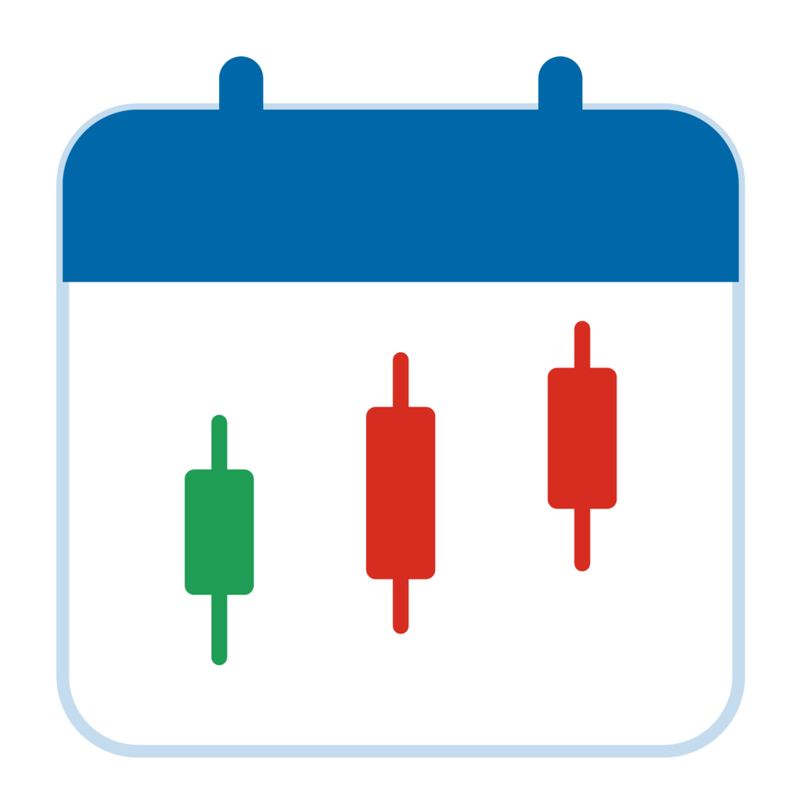
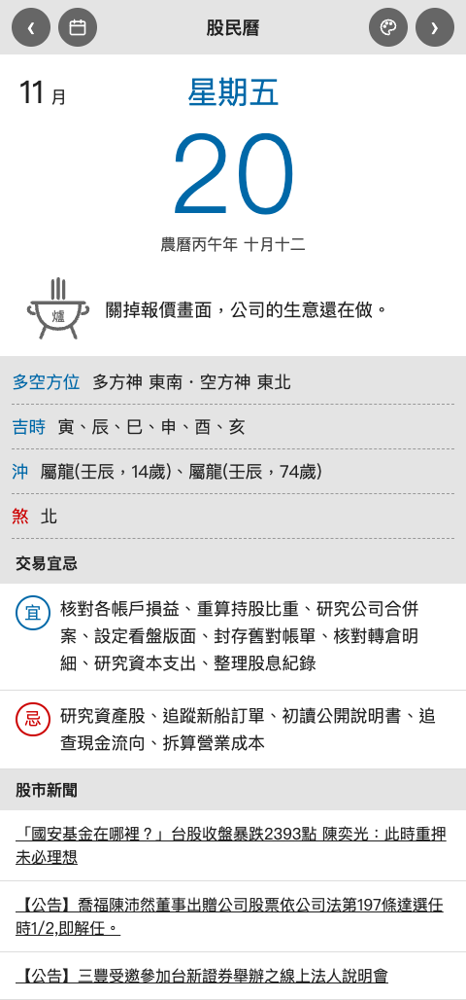

#  股民曆（StockDaily）

給股民的農民曆：https://stockdaily.awei.one

以 [IT Daily](https://github.com/chenwei791129/ITDaily) 為基礎，把傳統農民曆的宜忌轉成台股交易用語。



## 網站內容

- **國曆與農曆日期**，以及每日一句股市小語。
- **多空方位、吉時、沖、煞**：依農民曆資料產生，對應方式見下節。
- **宜／忌**：將當天農民曆的宜忌活動轉換為交易活動，例如「動土」對應「建立自選股清單」或「研究新產業」、「開市」對應「看開盤集合競價」或「記錄開盤價」。同一天所有人看到的內容都相同。
- **股市新聞**：合併所有啟用來源在最近 24 小時內的消息，依時間由新到舊顯示，預設最多 3 則 [Yahoo 股市最新新聞](https://tw.stock.yahoo.com/news)，點擊標題即可閱讀原文。來源與則數可自行設定，見[消息來源](#消息來源)。

使用 ‹ › 瀏覽前後一天，或按左上角的日曆圖示直接選擇日期（1900～2100 年），按「回今天」返回當天。新聞一律顯示最新內容，不隨瀏覽的日期改變。右上角的調色盤圖示可切換主題（預設、手寫風、科技風、復古風、宮廟風、乖乖風、看盤風），選擇會保存在瀏覽器中。

## 交易用語與農民曆的對應關係

農曆資料由 [`lunar-typescript`](https://www.npmjs.com/package/lunar-typescript) 提供，顯示時轉為正體中文。多方神、空方神和交易宜忌都是趣味轉譯，不是傳統神名，也不預測行情或提供買賣訊號。

| 網站內容 | 農民曆來源 | 轉換方式 |
|---|---|---|
| 多方神方位 | **喜神**方位 | 使用當日喜神方位（`getDayPositionXiDesc()`） |
| 空方神方位 | **福神**方位 | 使用當日福神方位（`getDayPositionFuDesc()`） |
| 每日一句股市小語 | 建除十二神（值日十二神） | 依當日的建、除、滿、平、定、執、破、危、成、收、開、閉選出一句；例如「成」對應「成交不是句點，交割日還在後面。」 |
| 吉時 | 各時辰的天神吉凶 | 取當日十二時辰中標示為「吉」的時辰，不納入屬於隔日的晚子時 |
| 沖 | 當日相沖的天干、地支與生肖 | 顯示相沖生肖、干支，以及以「農曆年減出生年」計算、介於 1～100 歲的對應年齡 |
| 煞 | 當日煞方 | 直接顯示農民曆的方位 |
| 宜／忌 | 當日宜忌活動 | 依活動對照表選出交易用語；以日期與原始活動決定選項，去除重複，且不讓同一文案同時出現在宜與忌 |

宜忌轉譯範例：

| 農民曆活動 | 可能顯示的交易用語 |
|---|---|
| 祭祀 | 翻交易日誌、重讀選股筆記 |
| 祈福 | 試算下檔風險、盤點備用現金 |
| 動土 | 建立自選股清單、研究新產業 |
| 嫁娶 | 研究公司合併案、試算換股比例 |
| 修造 | 修正估值假設、更新獲利試算 |

完整宜忌對照表見 [`src/yiji.ts`](src/yiji.ts)；神明方位、每日運勢及其他欄位的產生邏輯見 [`src/almanac.ts`](src/almanac.ts)。

## 自行架設

每次發布都會推送容器映像到 GitHub Container Registry（linux/amd64）：

```sh
docker run --rm -p 8080:8080 ghcr.io/chenwei791129/stockdaily:latest
```

啟動後開啟 http://localhost:8080 。

## 消息來源

「股市新聞」的內容來自一或多個消息來源。所有來源都內建在程式碼中，部署時以環境變數決定啟用哪些：

| 環境變數 | 格式 | 未設定或空白時 |
|---|---|---|
| `NEWS_SOURCES` | 以逗號分隔的來源 id，目前僅支援 `yahoo-stock` | `yahoo-stock` |
| `NEWS_LIMIT` | 正整數，最多顯示幾則 | `3` |

設定錯誤（不存在的 id、非正整數）時，容器會啟動失敗；Cloudflare Workers 的 `/api/news` 會回傳 500。

```sh
docker run --rm -p 8080:8080 -e NEWS_SOURCES=yahoo-stock -e NEWS_LIMIT=5 ghcr.io/chenwei791129/stockdaily:latest
```

內建來源：

| id | 內容 |
|---|---|
| `yahoo-stock` | [Yahoo 股市最新新聞 RSS](https://tw.stock.yahoo.com/rss)（預設） |

### 新增來源

1. 每個網站一個目錄：參考 [`src/news/sources/yahoo/`](src/news/sources/yahoo/) 新增 `src/news/sources/<網站>/index.ts`（測試放在同一目錄），匯出一個或多個 [`NewsSource`](src/news/source.ts)。每個來源要有唯一、以目錄名稱為前綴的 kebab-case `id`（例如 `yahoo-stock`），在 `fetch(signal)` 中抓取並回傳 `{ title, link, published }` 的清單；抓取失敗或沒有資料時請丟出錯誤，核心才會沿用上一次的內容。RSS 類來源可以重用 [`src/news/rss.ts`](src/news/rss.ts)。
2. 在 [`src/news/sources/index.ts`](src/news/sources/index.ts) 的 `SOURCES` 加入來源；`bun test` 會檢查 id 是否重複、格式是否正確。並在上方「內建來源」表格列出新的 id。
3. 部署時以 `NEWS_SOURCES` 啟用；若希望預設就啟用，也加進 `DEFAULT_SOURCES`。

24 小時的時間範圍、排序、去除重複、則數上限、30 分鐘快取與連結檢查由核心統一處理，來源不必自己做；一個來源抓取失敗時會沿用它上一次的內容，不影響其他來源。設計考量見 [ADR 0001](docs/adr/0001-news-sources-built-in-selected-by-config.md)。

## 開發

請參閱 [AGENTS.md](AGENTS.md)。

## 授權

[MIT](LICENSE)
